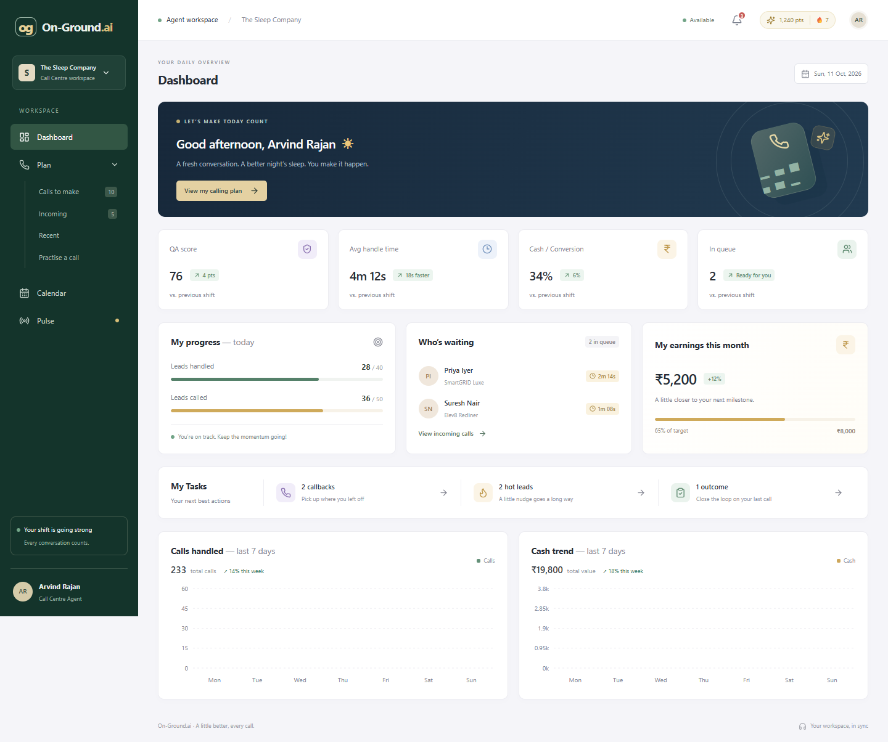
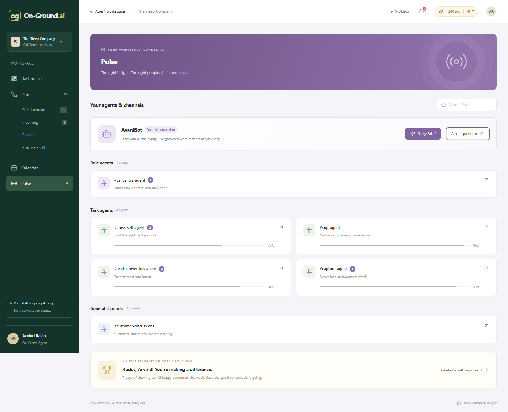
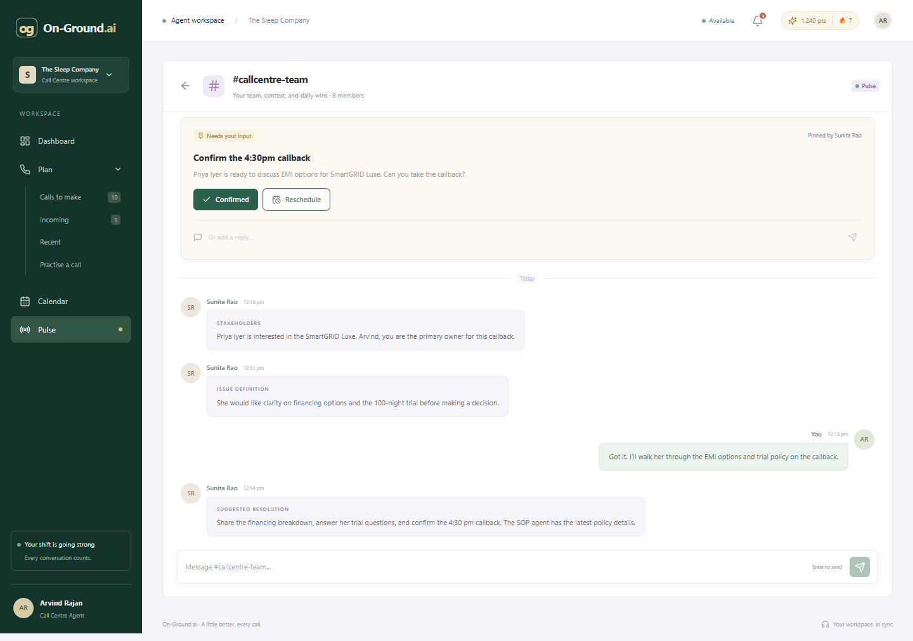
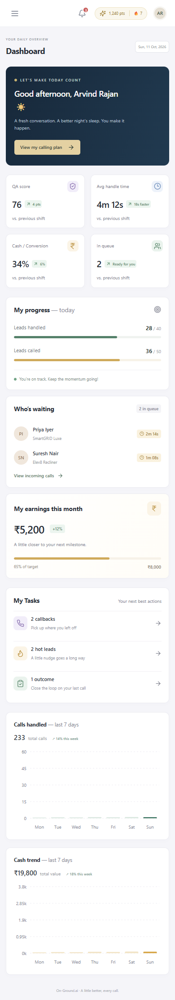

# On-Ground.ai Call Centre App

A compact, responsive agent workspace for **Arvind Rajan at The Sleep Company**. It brings the calling plan, performance, lead context, calendar, and team conversations into one place. All business data is mocked locally; there is no backend and no real call is placed.

## Preview









## Run locally

Requires Node.js 22.12+ (Node.js 24 recommended) and npm.

```sh
npm install
npm run dev
npm run build
npm run preview
```

Vite prints the local development URL. On Windows PowerShell with script execution disabled, use `npm.cmd` instead of `npm`.

```sh
npm run lint
npm run format:check
npm run test:e2e
```

Browser tests use an installed Google Chrome. Alternatively, install Chrome for Playwright with `npx playwright install chrome`. Screenshots are generated by the browser suite in `docs/screenshots/`.

## Stack and choices

| Tool                | Purpose and rationale                                                                    |
| ------------------- | ---------------------------------------------------------------------------------------- |
| React 18            | Small reusable components and hooks suit the agent's interactive workspace.              |
| Vite                | Fast development, production bundling, and lazy route chunks without a server framework. |
| TypeScript          | Strict, explicit models for leads, calls, channels, and messages; no `any`.              |
| React Router        | Bookmarkable screens and client-side navigation; routes load lazily.                     |
| Tailwind CSS 4      | Lightweight reset and utility styling, with plain CSS for the compact visual system.     |
| Recharts 3          | Responsive, accessible seven-day bar charts without hand-built chart rendering.          |
| Lucide React        | Consistent small SVG icons; no heavy UI kit.                                             |
| ESLint and Prettier | Hook checks, TypeScript syntax rules, and consistent formatting.                         |
| Playwright          | Tests real user journeys in Chrome, including keyboard interaction and mobile layout.    |

## Implemented

- Dashboard: four KPIs, daily progress, waiting customers, monthly earnings, actionable tasks, and two seven-day charts. Chart totals and progress percentages derive from mock data.
- Plan: score-ranked outgoing leads, expandable context, search, two-page pagination, missed callers with derived expected value, and recent-call review modals.
- Calendar: October 2026 initially, Monday-first month grid, event markers, date-specific agenda, month navigation, and a Today action using the actual current date in India Standard Time.
- Pulse: purple header, agent/channel search, daily brief, role and task agents, progress scores, unread badges, general channel, and Kudos card.
- Channels: stakeholder messages, left/right chat bubbles, timestamps, persistent message sending with automatic scrolling, and a pinned callback request resolved by confirmation, rescheduling, or a typed reply.
- Leads: five-lead paging, fit and intent scores, expandable evidence, customer signal quotes, and missed-value footer.
- Bonuses: practice screen, simulated call timer, mute/end controls, post-call outcome picker, browser-local outcome saving, responsive hamburger navigation, hover transitions, loading skeleton, search/agenda empty states, focus rings, reduced-motion support, and keyboard-accessible dialogs.
- AvaniBot: clearly labelled local demo assistant with prepared responses for financing, warranty, and the calling plan.

## Deliberate limits

Calls are simulations. Mute changes the demo state and does not request microphone access. AvaniBot uses prepared local guidance, not an AI API. Sending messages updates this browser only; it does not contact real coworkers. Saved outcomes are retained locally and do not mutate the original mock recent-call list. Reschedule posts a request to the team instead of booking a new calendar event. Calendar events are fixtures for October 2026.

The optional floating demo strip was skipped because the Plan and practice pages already expose the call flow. No mock HTML or reference screenshots were supplied, so styling follows the written brief. All application code was written for this project without referencing mock HTML source.

## Structure and design

```text
src/
  components/   Shell, Card, Badge, Pagination, Modal, KpiCard,
                LeadsModal, CallModal, ChatBubble
  pages/        Dashboard, Plan, Calendar, Pulse, Channel
  data/         Central typed mock fixtures
  hooks/        Browser-local state hook
  types/        Lead, call, channel, and message models
  lib/          INR formatting, IST dates and timestamps
  styles.css    Shared tokens, layout, interactions, responsive rules
tests/          Chrome end-to-end user journeys
docs/screenshots/
public/         Favicon and Netlify SPA redirect
```

Routes use `React.lazy` with a loading skeleton. Page-local state owns transient UI; messages, resolved requests, and call outcomes use namespaced `localStorage` keys. If storage is unavailable, interactions continue in memory. Channel state is keyed by channel ID to prevent cross-channel messages. There is no Redux or unnecessary global application state.

Reusable native `<dialog>` modals provide focus trapping, Escape dismissal, and focus restoration. Chart containers have explicit heights. Compact typography stays at a 13px base with 10–11px supporting labels and headings up to 20px. Sidebar, grids, tables, and channel composer adapt down to phone width.

## Verification

The Chrome suite covers dashboard rendering and chart presence; lead paging, Escape and focus restoration; calling-plan search and pagination; callback mute, timer and outcome saving; recent-call review; month navigation and real-date highlighting; Pulse search and persistent messages; callback confirmation; and horizontal overflow checks across all eight routes at 390px width.

## Deployment

The project includes `vercel.json` and `netlify.toml` so direct links such as `/pulse/callcentre-team` fall back to `index.html`. Import the GitHub repository into Vercel or Netlify, use `npm run build`, and publish `dist`. No secrets or runtime environment variables are required.

A private Sites deployment is also prepared through `.openai/hosting.json`. Its verified live URL will be added after publication. Vercel/Netlify account connection is required to deploy there.

## AI disclosure

**OpenAI Codex** was used to author and iterate on application code, mock fixtures, styling, tests, and documentation. No Claude, Cursor, or other AI tool was used in this session. The code is kept explicit and small so I can explain every part of the implementation, including the hooks, routes, calculations, and simulation boundaries; review it before submitting the assignment under your name.
